<picture><source media="(prefers-color-scheme: dark)" srcset="assets/header-dark.svg"><source media="(prefers-color-scheme: light)" srcset="assets/header-light.svg"></picture>

 

<a href="https://github.com/Botipy/spotify-widget"><picture><source media="(prefers-color-scheme: dark)" srcset="assets/project-01-dark.svg"><source media="(prefers-color-scheme: light)" srcset="assets/project-01-light.svg"></picture></a><a href="https://github.com/Botipy/roman-clip"><picture><source media="(prefers-color-scheme: dark)" srcset="assets/project-02-dark.svg"><source media="(prefers-color-scheme: light)" srcset="assets/project-02-light.svg"></picture></a><a href="https://github.com/Botipy/claude-usage-tracker"><picture><source media="(prefers-color-scheme: dark)" srcset="assets/project-03-dark.svg"><source media="(prefers-color-scheme: light)" srcset="assets/project-03-light.svg"></picture></a>

 

**Thanks for stopping by! ⭐**

